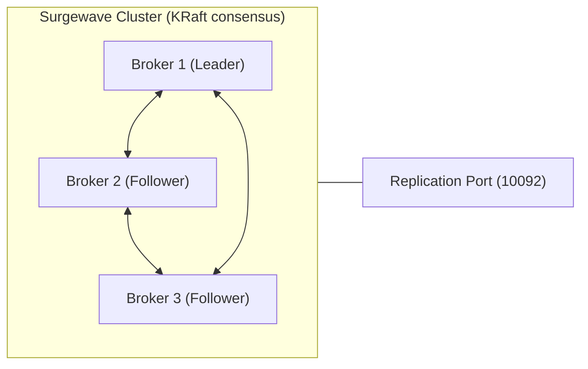

# Clustering Overview

Multi-broker setup for high availability and scalability.

## Architecture



## Features

| Feature | Description |
|---------|-------------|
| [Replication](replication.md) | Partition data replication |
| [KRaft](raft.md) | Consensus without ZooKeeper |
| [Failover](failover.md) | Automatic leader election |

## Quick Setup

### 3-Node Cluster

**Broker 1:**
```json
{
  "Surgewave": {
    "BrokerId": 1,
    "Host": "broker1",
    "BindAddress": "0.0.0.0",
    "Port": 9092,
    "ReplicationPort": 10092,
    "ClusterNodes": "1:broker1:9092:10092,2:broker2:9092:10092,3:broker3:9092:10092",
    "ControllerQuorumVoters": "1@broker1:10092,2@broker2:10092,3@broker3:10092"
  }
}
```

**Broker 2:**
```json
{
  "Surgewave": {
    "BrokerId": 2,
    "Host": "broker2",
    "BindAddress": "0.0.0.0",
    "Port": 9092,
    "ReplicationPort": 10092,
    "ClusterNodes": "1:broker1:9092:10092,2:broker2:9092:10092,3:broker3:9092:10092",
    "ControllerQuorumVoters": "1@broker1:10092,2@broker2:10092,3@broker3:10092"
  }
}
```

**Broker 3:**
```json
{
  "Surgewave": {
    "BrokerId": 3,
    "Host": "broker3",
    "BindAddress": "0.0.0.0",
    "Port": 9092,
    "ReplicationPort": 10092,
    "ClusterNodes": "1:broker1:9092:10092,2:broker2:9092:10092,3:broker3:9092:10092",
    "ControllerQuorumVoters": "1@broker1:10092,2@broker2:10092,3@broker3:10092"
  }
}
```

`Host` is the name clients and the other brokers are told; it is a DNS name here, so `BindAddress`
says what the client listener binds. `ClusterNodes` and `ControllerQuorumVoters` are the same on
every broker.

A broker is ready — it answers clients, `/health/ready` answers 200 — only once it has caught up
with the metadata log, which takes a leader and therefore a majority of the voters. Of three brokers
the first one alone is not ready; as soon as a second one runs, both are; the third starts or rejoins
at any time. Whatever starts the brokers must not wait for one to be ready before it starts the next.

## Cluster Settings

| Setting | Default | Description |
|---------|---------|-------------|
| `ClusterNodes` | "" | The brokers of the cluster, comma-separated, each `id:host:port:replicationPort` |
| `ControllerQuorumVoters` | "" | The brokers that vote on metadata, each `id@host:replicationPort`. Required as soon as `ClusterNodes` names other brokers |
| `BindAddress` | unset | Address the client listener binds where `Host` is a name |
| `ClusterId` | generated | Cluster identifier. Unset, the first controller generates one and every broker persists it (#203) |
| `ReplicationPort` | 10092 | Replication traffic port |
| `MinInSyncReplicas` | 1 | Minimum ISR for writes |

## CLI Commands

```bash
# Cluster status
surgewave cluster status
surgewave cluster nodes

# Partition operations
surgewave partitions elect-leader --topic my-topic
surgewave partitions elect-leader --all
```

## Replication Factor

Create topics with replication:

```bash
surgewave topics create my-topic --partitions 6 --replication-factor 3
```

## High Availability

For production:
- **3+ brokers** - Tolerate 1 failure
- **5 brokers** - Tolerate 2 failures
- **Replication factor 3** - Data durability
- **min.insync.replicas 2** - Write availability

## Next Steps

- [Replication](replication.md) - Data replication details
- [KRaft](raft.md) - Consensus protocol
- [Failover](failover.md) - Failure handling
