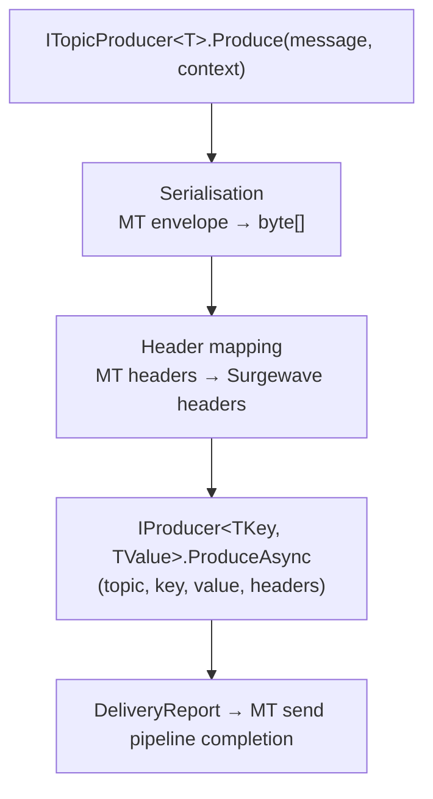

# MassTransit Rider for Kuestenlogik.Surgewave – Concept overview

**Status:** Concept / draft (Rev. 1)  
**Date:** 2026-04  
**Context:** Kuestenlogik.Surgewave – MassTransit integration

---

## Motivation

MassTransit is the most widely used messaging framework in the .NET ecosystem. Thousands of production systems use it as an abstraction layer over message brokers (RabbitMQ, Azure Service Bus, Amazon SQS, ActiveMQ) and as an application framework for consumers, sagas, routing slips and request/response patterns. The community is large, active and technically savvy.

With the move of MassTransit v9 to a commercial licensing model (Massient, Inc., April 2025), MassTransit v8 stays open under Apache 2.0 and is maintained until at least the end of 2026.

### Goals

1. **Zero-friction entry:** Existing MassTransit users can try Surgewave without changing their consumers, sagas or business logic.
2. **Migration path:** Teams that want to migrate from Kafka to Surgewave can do so within MassTransit — a configuration change, not a redesign.
3. **Consistent integration surface:** The rider complements the existing `Kuestenlogik.Surgewave.Compatibility.Confluent.Kafka` layer and the Akka.NET persistence integration.

---

## Architecture decision: rider, not transport

MassTransit distinguishes between **transports** and **riders**:

| Property | Transport | Rider |
|-------------|-----------|-------|
| Broker model | Queue-based (dispatch) | Log-based (pull) |
| Examples | RabbitMQ, Azure Service Bus, SQS | Kafka, Azure Event Hubs |
| Topology | Automatic (exchanges, queues, subscriptions) | Manual (topics exist beforehand) |
| Consumer model | Messages are dispatched and locked | Partitions are assigned to a consumer |
| Offset management | Broker manages delivery | Consumer manages commit |
| MassTransit API | `UsingRabbitMq()`, `UsingAzureServiceBus()` | `AddRider()` → `UsingKafka()` |

Architecturally, Surgewave is a log-based broker with a Kafka-compatible protocol. The semantic mapping is unambiguous: **Surgewave is a rider**, analogous to the existing Kafka rider. The advantage: the rider API is explicitly designed for topic/partition/offset semantics — exactly what Surgewave delivers natively.

---

## Current state in Surgewave

### Relevant building blocks

| Building block | Package | Function |
|----------|-------|----------|
| `ISurgewaveClient` | `Kuestenlogik.Surgewave.Client` | Unified client with protocol selection (Auto/Native/Kafka) |
| `IProducer<TKey, TValue>` | `Kuestenlogik.Surgewave.Client` | Typed producer with topic/partition/headers support |
| `IConsumer<TKey, TValue>` | `Kuestenlogik.Surgewave.Client` | Typed consumer with Subscribe/Assign/Seek/Commit |
| `SurgewaveClientBuilder` | `Kuestenlogik.Surgewave.Client` | Fluent builder with `UseSurgewaveProtocol()` / `UseKafkaProtocol()` |
| `SurgewaveClientExtensions` | `Kuestenlogik.Surgewave.Hosting` | DI integration (`AddSurgewaveProducer<>`, `AddSurgewaveConsumer<>`) |
| `SurgewaveRequestReplyClient` | `Kuestenlogik.Surgewave.Client` | Request/reply pattern over topics |
| `Confluent.Kafka` wrapper | `Kuestenlogik.Surgewave.Compatibility.Confluent.Kafka` | Drop-in replacement for `Confluent.Kafka` |

### Protocol options

| Protocol | Latency | Description |
|-----------|--------|--------------|
| `SurgewaveNative` | low (target) | Proprietary binary protocol, maximum performance |
| `Kafka` | Kafka-protocol baseline | Kafka wire protocol, compatibility with existing infrastructure |
| `Auto` | Optimal | Tries Surgewave Native, falls back to Kafka |

The rider uses `Kuestenlogik.Surgewave.Client` directly — **not** the `Confluent.Kafka` wrapper. Rationale: the wrapper emulates the Confluent API with synchronous polling semantics, while the rider can and should use the native async abstractions of `IProducer`/`IConsumer` directly.

---

## Target architecture

### Package structure

```
Kuestenlogik.Surgewave.Integration.MassTransit/         ← NuGet package
├── Configuration/
│   ├── SurgewaveRiderRegistrationExtensions.cs    ← AddRider(r => r.UsingSurgewave(...))
│   ├── ISurgewaveRiderConfigurator.cs             ← top-level configuration
│   ├── ISurgewaveTopicEndpointConfigurator.cs     ← consumer endpoint configuration
│   └── ISurgewaveProducerConfigurator.cs          ← producer configuration
├── Transport/
│   ├── SurgewaveRider.cs                          ← IRider implementation
│   ├── SurgewaveTopicReceiveEndpoint.cs           ← partition consumer pump
│   ├── SurgewaveReceiveContext.cs                 ← MassTransit ReceiveContext adapter
│   ├── SurgewaveConsumeContext.cs                 ← message → ConsumeContext<T> mapping
│   ├── SurgewaveHeaderAdapter.cs                  ← Surgewave headers ↔ MT headers
│   └── SurgewaveSendTransport.cs                  ← ITopicProducer → Surgewave producer
├── Serialization/
│   ├── SurgewaveMessageSerializer.cs              ← MT envelope → Surgewave value
│   └── SurgewaveMessageDeserializer.cs            ← Surgewave value → MT envelope
└── Diagnostics/
    ├── SurgewaveRiderHealthCheck.cs               ← IHealthCheck for consumer/producer
    └── SurgewaveActivitySource.cs                 ← OpenTelemetry integration
```

### Dependencies

```
Kuestenlogik.Surgewave.Integration.MassTransit
├── Kuestenlogik.Surgewave.Client           (Surgewave access)
├── Kuestenlogik.Surgewave.Hosting          (DI integration, optional)
├── MassTransit               (>= 8.0, < 10.0)
└── MassTransit.Abstractions  (rider interfaces)
```

The target version is **MassTransit v8** (Apache 2.0). Compatibility with v9 (commercial) is desirable but secondary — v8 has the larger installed base and is free of licence costs. The API surface of the rider abstraction is stable between v8 and v9, so an upgrade is not expected to require breaking changes.

---

## API design

### Registration (developer-facing)

```csharp
services.AddMassTransit(bus =>
{
    bus.UsingInMemory((context, cfg) => cfg.ConfigureEndpoints(context));

    bus.AddRider(rider =>
    {
        // Register the consumer
        rider.AddConsumer<OrderEventConsumer>();

        // Register the producer
        rider.AddProducer<string, OrderEvent>("order-events");

        // Configure Surgewave as the rider
        rider.UsingSurgewave((context, surgewave) =>
        {
            surgewave.Host("localhost:9092");

            // Optional protocol selection (default: Auto)
            surgewave.UseSurgewaveProtocol();  // or: UseKafkaProtocol(), UseAutoProtocol()

            // Consumer endpoint
            surgewave.TopicEndpoint<OrderEvent>("order-events", "order-service", e =>
            {
                e.ConfigureConsumer<OrderEventConsumer>(context);
                e.AutoOffsetReset = AutoOffsetReset.Earliest;
                e.ConcurrentConsumerLimit = 4;
                e.ConcurrentDeliveryLimit = 1;  // ordering within a key
            });
        });
    });
});
```

### Producer usage

```csharp
public class OrderService(ITopicProducer<string, OrderEvent> producer)
{
    public async Task SubmitOrder(Order order)
    {
        await producer.Produce(new OrderEvent
        {
            OrderId = order.Id,
            CustomerId = order.CustomerId,
            Total = order.Total
        }, context =>
        {
            context.Headers.Set("correlation-id", order.CorrelationId.ToString());
        });
    }
}
```

### Consumer implementation

```csharp
public class OrderEventConsumer : IConsumer<OrderEvent>
{
    public async Task Consume(ConsumeContext<OrderEvent> context)
    {
        var order = context.Message;
        var correlationId = context.Headers.Get<string>("correlation-id");

        // Business logic — identical to the Kafka rider or any other transport
        await ProcessOrderAsync(order);
    }
}
```

### Comparison with the Kafka rider

| Aspect | Kafka rider | Surgewave rider |
|--------|-------------|-------------|
| Host configuration | `k.Host("localhost:9092")` | `s.Host("localhost:9092")` |
| TopicEndpoint | `k.TopicEndpoint<T>(...)` | `s.TopicEndpoint<T>(...)` |
| AddProducer | `rider.AddProducer<T>(topic)` | `rider.AddProducer<TKey,TValue>(topic)` |
| Client library | `Confluent.Kafka` | `Kuestenlogik.Surgewave.Client` |
| Protocol choice | Kafka only | Surgewave Native / Kafka / Auto |
| Performance | Kafka latency | Up to lower latency (Surgewave Native) |

The API surface is deliberately almost identical to the Kafka rider. Developers who know MassTransit with Kafka should understand the Surgewave rider immediately. The only visible difference is `UsingSurgewave()` instead of `UsingKafka()` and the optional protocol selection.

---

## Component design

### 1. SurgewaveRider (IRider)

The `SurgewaveRider` implements MassTransit's `IRider` interface and is responsible for:

- Lifecycle management: start/stop of the `ISurgewaveClient` with the host
- Endpoint management: starting the configured TopicEndpoints as consumer pumps
- Producer registry: management of the registered `ITopicProducer<TKey, TValue>` instances
- Health reporting: aggregated health status of all endpoints

```
IRider
├── Start()      → SurgewaveClient.ConnectAsync() + start all TopicEndpoints
├── Stop()       → stop all TopicEndpoints + SurgewaveClient.DisposeAsync()
└── GetProducer() → ITopicProducer<TKey, TValue> from the registry
```

### 2. SurgewaveTopicReceiveEndpoint

Every configured TopicEndpoint becomes a `SurgewaveTopicReceiveEndpoint` instance:

```
SurgewaveTopicReceiveEndpoint
├── Consumer pool:  N consumer instances (ConcurrentConsumerLimit)
├── Partition loop: one ConsumeAsync loop per partition
├── Delivery:       ConsumeResult → SurgewaveConsumeContext → MassTransit pipeline
├── Commit:         after successful processing → CommitAsync
└── Error:          on fault → retry/DLQ according to the MT configuration
```

**Concurrency model:**

The Kafka rider uses `ConcurrentConsumerLimit` to scale across partitions and `ConcurrentDeliveryLimit` for parallel processing within a partition (by key). The Surgewave rider adopts this model:

- `ConcurrentConsumerLimit = N` → N Surgewave consumer instances, each reading from its own partitions
- `ConcurrentDeliveryLimit = 1` (default) → ordering within a key guaranteed
- `ConcurrentDeliveryLimit > 1` → parallel delivery, ordering only within a key

### 3. SurgewaveSendTransport (producer)

The `SurgewaveSendTransport` adapts MassTransit's `ITopicProducer<T>` to Surgewave's `IProducer<TKey, TValue>`:



### 4. Serialisation

MassTransit uses its own envelope format with a message type URN, headers, conversation ID, correlation ID and further metadata. The Surgewave rider must serialise this envelope transparently:

**Recommended strategy: MassTransit-native serialisation**

- **Value:** the MassTransit envelope as JSON (or MessagePack, if configured) in the Surgewave message value. This matches the behaviour of the Kafka rider.
- **Headers:** MassTransit transport headers (MessageId, ConversationId, CorrelationId, SourceAddress, DestinationAddress, MessageType) as Surgewave message headers.
- **Key:** configurable key selector, default: CorrelationId or MessageId.

This strategy ensures that MassTransit consumers receive the full MT metadata and that features such as sagas, retry and fault handling work correctly.

### 5. Offset commit strategy

| Mode | Behaviour | Use |
|-------|-----------|---------|
| `AutoCommit` | Commit after every successful delivery | Default, simple |
| `BatchCommit` | Commit after N messages or a time interval | Throughput-optimised |
| `ManualCommit` | The consumer controls the commit explicitly | Exactly-once semantics |

The default is `AutoCommit` after successful consumer pipeline completion — analogous to the Kafka rider.

### 6. Health checks and diagnostics

```csharp
// Registered automatically via AddRider
services.AddHealthChecks()
    .AddSurgewaveRiderHealthCheck("surgewave-rider");

// OpenTelemetry
builder.Services.AddOpenTelemetry()
    .WithTracing(t => t.AddSource("Kuestenlogik.Surgewave.MassTransit"));
```

The health check reports:

- **Healthy:** all consumers connected, all partitions assigned
- **Degraded:** some partitions not assigned (rebalance in progress)
- **Unhealthy:** no connection to the broker

OpenTelemetry spans are created for produce and consume, with propagation of the TraceContext headers via Surgewave message headers.

---

## Migration paths

### Path 1: Kafka → Surgewave (within MassTransit)

```diff
 bus.AddRider(rider =>
 {
     rider.AddConsumer<OrderEventConsumer>();
-    rider.UsingKafka((context, k) =>
+    rider.UsingSurgewave((context, s) =>
     {
-        k.Host("kafka:9092");
-        k.TopicEndpoint<OrderEvent>("order-events", "order-service", e =>
+        s.Host("surgewave:9092");
+        s.TopicEndpoint<OrderEvent>("order-events", "order-service", e =>
         {
             e.ConfigureConsumer<OrderEventConsumer>(context);
         });
     });
 });
```

Consumer code, saga code, routing slips — everything stays unchanged. Only the rider configuration changes.

### Path 2: Confluent.Kafka → Surgewave (migration to MassTransit)

For teams that have so far used `Confluent.Kafka` directly and want to migrate to MassTransit, the Surgewave rider offers an incentive: they get MassTransit features (sagas, retry, outbox pattern) and Surgewave performance in one step.

### Path 3: Dual rider (Kafka + Surgewave in parallel)

MassTransit supports several riders side by side. A team can run Kafka and Surgewave in parallel and migrate step by step:

```csharp
bus.AddRider(rider =>
{
    // Legacy topics on Kafka
    rider.UsingKafka((context, k) =>
    {
        k.Host("kafka:9092");
        k.TopicEndpoint<LegacyEvent>("legacy-topic", "group", e => { /* ... */ });
    });
});

bus.AddRider(rider =>
{
    // New topics on Surgewave
    rider.UsingSurgewave((context, s) =>
    {
        s.Host("surgewave:9092");
        s.TopicEndpoint<NewEvent>("new-topic", "group", e => { /* ... */ });
    });
});
```

---

## Feature parity with the Kafka rider

| Feature | Kafka rider | Surgewave rider (target) | Priority |
|---------|-------------|---------------------|-----------|
| TopicEndpoint with consumer | ✓ | ✓ | P0 |
| ITopicProducer | ✓ | ✓ | P0 |
| Consumer groups | ✓ | ✓ | P0 |
| Offset commit (auto/manual) | ✓ | ✓ | P0 |
| Headers propagation | ✓ | ✓ | P0 |
| ConcurrentConsumerLimit | ✓ | ✓ | P0 |
| ConcurrentDeliveryLimit | ✓ | ✓ | P1 |
| Retry / kill switch | ✓ | ✓ | P1 |
| Health checks | ✓ | ✓ | P1 |
| OpenTelemetry spans | ✓ | ✓ | P1 |
| CreateIfMissing (topic) | ✓ | ✓ | P2 |
| Schema Registry | ✓ (Confluent) | ✓ (Surgewave Schema Registry) | P2 |
| Avro/Protobuf serializer | ✓ | ✓ (via the Surgewave SchemaRegistry packages) | P2 |
| Multiple types per topic | ✓ (custom) | ✓ | P3 |

---

## Licensing and publication

### Package licence

`Kuestenlogik.Surgewave.Integration.MassTransit` is published under **Apache 2.0**. Rationale:

- MassTransit v8 is Apache 2.0 — an Apache 2.0 rider fits seamlessly in licensing terms
- Apache 2.0 removes adoption barriers for users completely
- The package has a runtime dependency on `Kuestenlogik.Surgewave.Client`, which is part of the Apache 2.0 Surgewave core — the integration as well as the client and broker are free of charge and permissively licensed

### NuGet package name

**Recommendation:** `Kuestenlogik.Surgewave.Integration.MassTransit`

Alternatives:
- `MassTransit.Surgewave` — more firmly anchored in the MassTransit world, but suggests membership of the MassTransit project
- `Kuestenlogik.Surgewave.MassTransit` — shorter, but unclear whether it is a consumer or a tool

The name `Kuestenlogik.Surgewave.Integration.MassTransit` follows the naming scheme of the Küstenlogik ecosystem and clearly signals the direction of the dependency.

### NuGet publication

The package is published on nuget.org with:
- Tags: `masstransit`, `surgewave`, `kafka`, `messaging`, `event-streaming`, `rider`
- README with migration path documentation
- Icon: Surgewave logo
- Minimum dependencies: MassTransit >= 8.0, Kuestenlogik.Surgewave.Client

---

## Implementation plan

### Phase 1: core rider (P0)

**Goal:** functional parity for produce/consume with the Kafka rider.

1. `ISurgewaveRiderConfigurator` — host, protocol, client options
2. `SurgewaveRider : IRider` — lifecycle, client management
3. `SurgewaveTopicReceiveEndpoint` — consumer pump with partition assignment
4. `SurgewaveSendTransport` — producer with MT envelope serialisation
5. `SurgewaveConsumeContext` / `SurgewaveReceiveContext` — message pipeline adapters
6. `SurgewaveHeaderAdapter` — bidirectional header mapping
7. Registration extensions: `UsingSurgewave()`, `TopicEndpoint<T>()`, `AddProducer<>()`

**Result:** a MassTransit user can configure Surgewave as a rider, produce and consume messages.

### Phase 2: production readiness (P1)

1. ConcurrentDeliveryLimit with key-based parallelisation
2. Retry integration (MassTransit retry pipeline)
3. Kill switch support
4. Health checks (`IHealthCheck`)
5. OpenTelemetry instrumentation (`ActivitySource`)
6. Testcontainers integration (`Testcontainers.Surgewave` + MassTransit test harness)

**Result:** production-ready with observability and resilience.

### Phase 3: ecosystem integration (P2/P3)

1. Schema registry integration (Surgewave Schema Registry ↔ MT serializer)
2. CreateIfMissing via the Surgewave Admin API
3. Topic configuration (partitions, retention) via the endpoint config
4. Multiple message types per topic
5. Saga state machine support (validation/documentation)

**Result:** feature-complete, comparable with the Kafka rider.

---

## Open questions

1. **MassTransit v9 compatibility:** Should the package be actively tested against v9, even though v9 is commercial? Recommendation: yes, but with v8 as the primary target.
2. **Confluent.Kafka fallback:** Should the rider optionally be able to use the `Confluent.Kafka` wrapper to talk to real Kafka clusters via MassTransit?
3. **Separate repository or monorepo:** Does the package live in the Surgewave repo or in its own `surgewave-integrations` repo? Recommendation: its own repo (`Kuestenlogik.Surgewave.Integrations`) with its own release cycle, since MassTransit version jumps happen independently of Surgewave releases.
